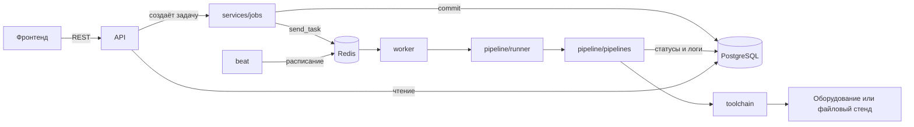

# Бэкенд: структура и логика

Серверная часть платформы: REST API на FastAPI, PostgreSQL с миграциями Alembic, фоновые задачи
Celery через Redis. Все сетевые операции идут в воркере, API их только ставит в очередь и отдаёт
статус.

## Из чего состоит стек

`docker-compose.yml` в корне поднимает семь сервисов:

| Сервис | Что делает |
|---|---|
| `postgres` | Устройства, задачи, логи, снимки конфигов, история дрейфа, метрики |
| `redis` | Брокер очереди Celery |
| `api` | При старте применяет миграции, затем отдаёт REST и Swagger на порту 8000 |
| `worker` | Выполняет задачи: сбор конфигов, дифф, деплой, сбор метрик |
| `beat` | Расписание: скан дрейфа, сбор метрик, добивание зависших задач |
| `prometheus` | Снимает `/metrics` с API |
| `telegram-bot` | Оповещения о дрейфе и падениях, команды `/status`, `/drift`, `/jobs`, `/metrics` |

Один и тот же образ используется для `api`, `worker`, `beat` и `telegram-bot` — отличается только
команда запуска.

## Структура пакета

```
backend/netops/
├── api/              HTTP-слой: роутеры, зависимости, обработка ошибок
│   ├── app.py        сборка FastAPI, CORS, контейнер зависимостей
│   ├── deps.py       сессия БД, аутентификация по токену/сессии, проверка роли и allowed_system
│   ├── errors.py     исключения домена → коды HTTP
│   └── routes/       auth, config, devices, jobs, drift, telemetry, insights (+ insights_copilot), emergency (+ emergency_reset), system (+ system_git_integrations), users
├── schemas/          Pydantic-модели запросов и ответов API
├── services/         Прикладная логика (все модули < 500 строк)
│   ├── jobs.py       создание задач, проверки конфликтов (SELECT FOR UPDATE), постановка в очередь
│   ├── devices.py    CRUD устройств, импорт инвентаря
│   ├── retention.py  пред-коллекторный чистильщик логов (/var/log/netops/*.log), RAM-кэшей и старых записей БД
│   ├── state.py      StateManager (Redis + PostgreSQL SystemState + Memory fallback)
│   ├── state_domains.py миксин блокировок, кэшей телеметрии/шаблонов и Factory Freeze
│   ├── discovery.py  оркестратор SSH-зондирования (/devices/probe), онбординга и привязки к SoT
│   ├── discovery_profiles.py профили платформ (intent/platforms/*.yaml) и детекция баннеров
│   ├── discovery_parsers.py  парсеры железа, интерфейсов и LLDP-топологии
│   ├── discovery_brownfield.py извлечение BGP/ACL и генерация YAML-интента из running-config
│   ├── bootstrap.py, bootstrap_discovery.py, bootstrap_exposure.py, bootstrap_owner.py
│   ├── telemetry.py, telemetry_parsers.py, telemetry_prometheus.py
│   ├── git_sot.py, chaos.py, drift.py, users.py, sessions.py
│   └── forecast.py, ai_guard.py, freeze.py, notifier.py, llm.py
├── pipeline/         Выполнение задач в воркере
│   ├── runner.py     берёт задачу по id, блокирует строку, выбирает пайплайн
│   ├── pipelines.py  четыре пайплайна: dry-run, deploy, скан и устранение дрейфа
│   ├── planning.py   рендер intent, сбор running-config, нормализация, дифф
│   ├── deployment.py транзакционное применение с post-check и откатом
│   └── recorder.py   статусы задачи и журнал шагов
├── network/          Единый коннектор к оборудованию и работа с конфигами
│   ├── base.py       протоколы: коллектор, деплойер, health-проба, дифф, рендер
│   ├── ssh_pool.py   пул постоянных SSH-сессий (_SESSION_POOL), мьютексы (_DEVICE_LOCKS) и опциональный Jump
│   ├── table_parsers.py единый парсер таблиц BGP, интерфейсов и потерь ping
│   ├── scrapli_driver.py транзакционный драйвер по SSH (Cisco IOS-XE, Arista EOS, Huawei VRP, Eltex, Linux)
│   ├── offline.py    файловый стенд для разработки и CI (lab/running/)
│   ├── rendering.py  Jinja2 со StrictUndefined (templates/<platform>/*.j2)
│   ├── normalization.py фильтры диффа по правилам из diff_filters.yaml
│   ├── diff_filters.yaml декларативные правила очистки CLI по вендорам
│   ├── diff.py       расчёт патчей наката и отката через hier_config
│   └── health.py     правила Health-Check: что считать аварией
├── intent/           Источник правды: YAML-репозиторий
│   ├── models.py     схема inventory.yaml и devices/<hostname>.yaml
│   ├── repository.py чтение и запись файлов в intent/
│   ├── lint.py       проверки по фабрике: дубли router-id и адресов
│   └── netbox.py     синхронизация топологии с форматом NetBox
├── models/           Таблицы SQLAlchemy (Device, Job, ConfigSnapshot, DriftRecord, User, SystemState)
├── telemetry/        Единый конвейер метрик и телеграм-бот
│   ├── metrics.py    каталог метрик и вывод в формате Prometheus
│   ├── collector.py  пред-очистка (pre_collect_cleanup), сбор среза и прямой пуш в VictoriaMetrics
│   ├── targets.py    авто-генерация целей для gnmic, snmp_exporter и node_exporter
│   └── bot.py (+ bot_auth.py, bot_views.py, bot_actions.py)
├── worker/           Celery: приложение, расписание, задачи
├── db/               Движок, сессии, базовый класс, ожидание базы при старте
├── settings.py       Все настройки из переменных NETOPS_* и Runtime Overlay
├── constants.py      Чтение констант из config/constants.yaml
├── enums.py          Платформы, роли, статусы устройств и задач
└── toolchain.py      Сборка набора инструментов под текущий драйвер
```


## Как связаны слои



Главное правило: **API не ходит в сеть**. Он создаёт запись задачи, кладёт id в очередь и сразу
отвечает `202` с `job_id`. Фронтенд опрашивает `GET /api/v1/jobs/{id}` и `/logs`.

Зависимости направлены в одну сторону: `api` → `services` → `models`, а `pipeline` → `toolchain` →
`network`. Пайплайны не знают, что находится на другом конце — только протоколы из
`network/base.py`.

## Жизненный цикл задачи

```
PENDING ──> RUNNING ──> SUCCESS
   │           │
   └──────────-┴──────> FAILED
```

Переходы разрешены таблицей `ALLOWED_TRANSITIONS` в `models/job.py`, остальные дают исключение.
Кто что делает:

- **PENDING** — задачу создал `services/jobs.py` и записал в базу;
- **RUNNING** — воркер взял её: `runner.py` блокирует строку (`SELECT ... FOR UPDATE`), поэтому
  повторно доставленное сообщение Celery не запустит задачу дважды;
- **SUCCESS** — все устройства обработаны без ошибок;
- **FAILED** — упало хотя бы одно устройство, либо пайплайн выбросил ошибку, либо задача зависла
  (`beat` переводит её в `FAILED` через `NETOPS_JOB_TIMEOUT_SECONDS` и освобождает устройства).

У каждого устройства задачи свой статус: `PENDING`, `SUCCESS`, `FAILED`, `SKIPPED`, `ROLLED_BACK`.
Прогресс задачи: у dry-run и скана по этапам (рендер — 33 %, сбор — 66 %), у деплоя — по
устройствам. Упавшая задача сохраняет прогресс того этапа, где остановилась.

Каждая строка журнала пишется в `job_logs` с коммитом сразу (`recorder.py`), поэтому логи видны по
ходу выполнения, а не после завершения. Фронтенд забирает их по `after_id`.

## Четыре типа задач

### DRY_RUN — холостой прогон

1. **Pre-flight lint** всего репозитория intent. Если есть ошибки — задача `FAILED` и к сети
   обращений не было вообще.
2. **Рендер** intended-конфига из шаблонов Jinja2 по каждому устройству.
3. **Сбор** running-config со всех устройств (у драйвера это параллельно).
4. **Нормализация** обеих сторон по правилам из `diff_filters.yaml`.
5. **Дифф** через hier_config: патч наката, патч отката, лишние и недостающие строки.
6. **Сохранение**: снимки конфигов в `config_snapshots` с хешем SHA-256, патчи в `job_targets`.

Ошибка по одному устройству не роняет остальные: оно помечается `FAILED` со своей причиной.

### DEPLOY — применение

Создаётся только из успешного dry-run с изменениями, одно подтверждение на один dry-run.
Устройства обрабатываются по очереди; после первой ошибки остальные получают `SKIPPED` — чтобы не
разносить поломку по всей фабрике.

По каждому устройству (`deployment.py`):

| Шаг | Что происходит | Если упало |
|---|---|---|
| `verify` | Сверка running-config с хешем из dry-run | Отказ: «конфиг изменился, сделайте новый dry-run» |
| `pre-check` | Снимок состояния до изменения | `FAILED`, применения не было |
| `apply` | Патч с `commit confirmed <таймер>` | Откат, статус устройства возвращается |
| `post-check` | Проверка здоровья, с повторами | Откат, устройство `ROLLED_BACK` |
| `commit` | Подтверждение транзакции | `UNKNOWN`: по истечении таймера устройство откатится само |

Смысл `commit confirmed`: если платформа не подтвердит изменение, оборудование само вернёт прежний
конфиг по таймеру. Поэтому потеря связи во время деплоя не оставляет сеть в сломанном состоянии.

Если и post-check, и откат не удались — устройство получает `UNKNOWN` и сообщение о том, что нужно
вмешательство руками.

### DRIFT_SCAN — поиск расхождений

Те же шаги, что у dry-run, но вместо патча пишется запись в `drift_records` и статус устройства:

- `IN_SYNC` — расхождений нет;
- `DRIFT_DETECTED` — есть лишние или недостающие строки;
- `UNREACHABLE` — устройство не ответило.

Запускается по расписанию (`NETOPS_DRIFT_SCAN_INTERVAL_SECONDS`, по умолчанию 15 минут) или
вручную. Плановый скан пропускается, если предыдущий ещё идёт. Устройства, на которых в этот момент
идёт деплой, пропускаются.

### DRIFT_REMEDIATE — устранение дрейфа

Патч пересчитывается заново от текущего running-config (а не берётся из прошлого скана) и
прогоняется через тот же транзакционный деплой с post-check и откатом.

## Правила post-check

Логика в `network/health.py`, пороги в настройках. При dry-run из intent запоминается, что заявлено
для устройства (BGP-соседи и интерфейсы), и это хранится в `job_targets.health_expectations`.

После применения проверяется:

- каждый заявленный сосед — `Established` и принимает префиксы (`> 0`);
- каждый включённый заявленный интерфейс — `up/up`; выключенные в intent могут лежать;
- интерфейсы вне intent проверяются на регрессию: был `up/up` — должен остаться;
- потери ping не больше `NETOPS_MAX_PING_LOSS_PERCENT` (по умолчанию 20 %).

Сосед, удалённый из intent, может пропасть — это не авария. Пока BGP сходится, проверка
повторяется `NETOPS_POST_CHECK_ATTEMPTS` раз с интервалом `NETOPS_POST_CHECK_INTERVAL_SECONDS`;
не прошла последняя попытка — откат.

## Нормализация и дифф

Перед сравнением обе стороны проходят через `normalization.py` с правилами из `diff_filters.yaml`:

1. маскируются хэши паролей;
2. отбрасываются служебные строки и блоки целиком (сертификаты, метки времени, счётчики);
3. остаются только управляемые секции (`managed_sections`) — и в скане, и в dry-run. Поэтому
   management-порт, пользователи и `aaa` не дают ложного дрейфа, а патч наката их не трогает;
4. убираются неявные строки (`no shutdown`, `undo shutdown`), которых нет в выводе устройства;
5. отступы приводятся к одному виду, чтобы шаблон с четырьмя пробелами и вывод Arista с тремя
   давали одинаковый текст.

Дифф считает hier_config: `cisco_ios` для IOS-XE, `arista_eos`, `huawei_vrp`, для Eltex — общий
драйвер. Результат — `remediation`, `rollback`, `unauthorized_lines`, `missing_lines`.

## Точки расширения

Пайплайн работает с сетью только через протоколы из `network/base.py`:

| Протокол | Метод | Назначение |
|---|---|---|
| `ConfigCollector` | `fetch_running_configs(targets)` | Параллельный сбор конфигов. Ошибка по устройству — через `FetchResult.failure`, не исключением |
| `ConfigDeployer` | `apply` / `confirm` / `rollback` | Транзакционное применение с таймером |
| `HealthProbe` | `snapshot(target, expected)` | Состояние BGP, интерфейсов, потери ping |
| `DiffEngine` | `compare(platform, running, intended)` | Патчи наката и отката |
| `ConfigRenderer` | `render(device, intent)` | Intended-конфиг из шаблонов |

Новая реализация подключается в `build_toolchain()` (`toolchain.py`) под своим значением
`NETOPS_NETWORK_DRIVER` — оркестрацию менять не нужно. Сейчас есть два драйвера: `offline`
(файловый стенд, `lab/running/<hostname>.cfg`) и `scrapli` (живой SSH).

## Таблицы

| Таблица | Что хранит |
|---|---|
| `devices` | Инвентарь: hostname, адрес управления, платформа, роль, профиль доступа, статус |
| `jobs` | Задачи: тип, статус, прогресс, автор, подтвердивший, ошибка, времена |
| `job_targets` | Устройства задачи: статус, патчи, ссылки на снимки, ожидания post-check |
| `job_logs` | Журнал по шагам: уровень, шаг, устройство, сообщение |
| `config_snapshots` | Снимки конфигов (running и intended) с хешем SHA-256 |
| `drift_records` | История проверок: статус, лишние и недостающие строки, патчи |
| `users` | Пользователи и хеши токенов |

Миграции в `backend/migrations/versions/`. Тест `test_migrations.py` сверяет результат миграций с
моделями, поэтому забытая миграция роняет сборку.

## API и роли

Авторизация — заголовок `Authorization: Bearer <token>` или сессионная HttpOnly cookie (`netops_session` + `X-CSRF-Token`), а также выделенные ролевые порты фронтенда (`5173` Owner, `5174` Admin, `5175` Operator, `5176` Viewer). Четыре роли и ограничение области видимости `allowed_system`:

| Роль | Что может |
|---|---|
| `viewer` | Чтение: устройства (в рамках `allowed_system`), задачи, логи, дифф, отчёт по дрейфу, прогноз телеметрии |
| `operator` | Плюс dry-run, деплой, скан и устранение дрейфа, Chaos-сценарии и Change Freeze по разрешённому стенду |
| `admin` | Плюс импорт инвентаря, CRUD устройств, аварийный CLI (только безопасные диагностические команды из белого списка) и управление пользователями |
| `owner` | Полный доступ: настройка всех 5 слоёв Матрёшки, глобальный Git SoT (с безопасной передачей токенов через `GIT_CONFIG_*`), смена режимов публикации и хард-сброс |

Первые токены задаются в `NETOPS_API_TOKENS`, дальше администратор или владелец создаёт пользователей через API или Telegram-бот — токен показывается один раз, в базе лежит только его SHA-256. Все эндпоинты (`/devices`, `/jobs`, `/drift`, `/insights`, `/emergency`, `/system/chaos`, `/system/freeze`) строго проверяют принадлежность устройства и стенда контуру `allowed_system`.

Коды ошибок: `404` — нет сущности, `409` — конфликт состояния (dry-run не успешен, устройство уже деплоится или удерживает `sync_lock`), `422` — ошибка валидации (для intent со списком `issues` с файлом и полем), `503` — очередь недоступна, задача сразу помечается `FAILED`.

Без токена доступны только `/healthz`, `/readyz`, `/metrics` и публичный статус инициализации `/api/v1/system/bootstrap/status`.

## Метрики и бот

Воркер раз в `NETOPS_METRICS_INTERVAL_SECONDS` собирает замеры и публикует последний срез в Redis (`netops:telemetry:latest`) и `StateManager`: статусы устройств, задачи по типам и статусам, дрейф — из базы; состояние BGP-сессий, портов и потери ping — со стенда через тот же `HealthProbe`, что и post-check (с мультиплексированием `direct-tcpip` каналов через общий SSH Jump-клиент `_SHARED_JUMP_CLIENTS` и проверкой `SSH-` баннера). `GET /metrics` отдаёт этот срез в формате Prometheus. Историю хранит не PostgreSQL, а VictoriaMetrics (Prometheus → `remote_write`). Устройства с подтверждённым gNMI / exporter / SNMP раз в час раскладываются по целям gnmic и Prometheus file_sd (`netops/telemetry/targets.py`).

Бот читает ту же базу: оповещает при смене состояния устройства (появился дрейф, стало недоступно, снова совпало с эталоном) и об упавших задачах (с экранированием `html.escape`), а также отвечает на команды и выдаёт персональные ссылки с привязкой к устройству.

## Тесты

```bash
/tmp/croc_venv/bin/pytest backend/tests -q   # 626 тестов (414 unit + 212 integration), SQLite, без Redis и сети
/tmp/croc_venv/bin/ruff check backend/netops
```

Тесты идут на SQLite и файловом стенде, поэтому не требуют ни оборудования, ни Redis. Отдельно есть smoke-тест поднятого стека: `python3 backend/scripts/smoke_stack.py` проверяет миграции, проход dry-run и скана через воркер, плановую задачу от Beat, сбор метрик и состояние всех контейнеров.
