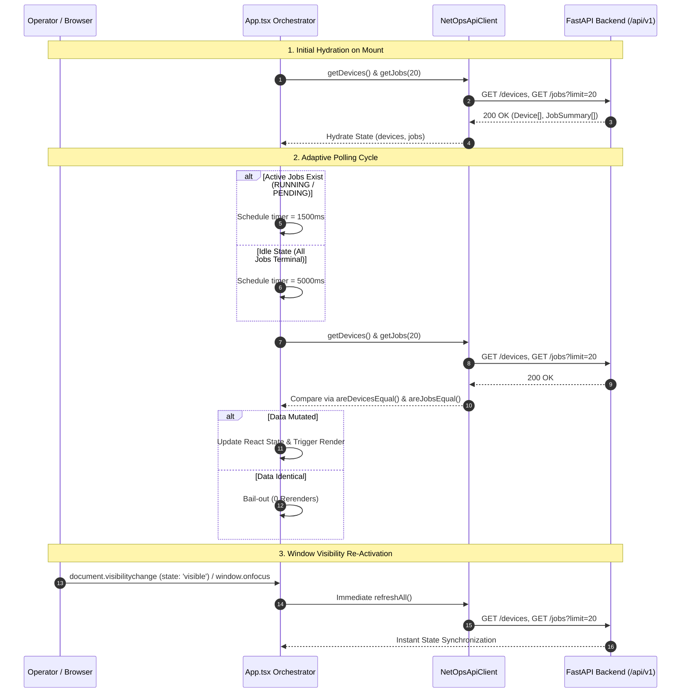
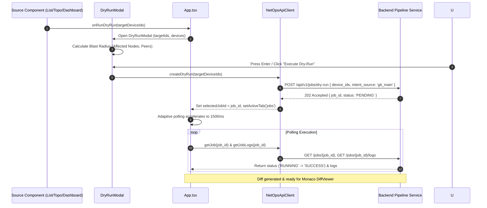
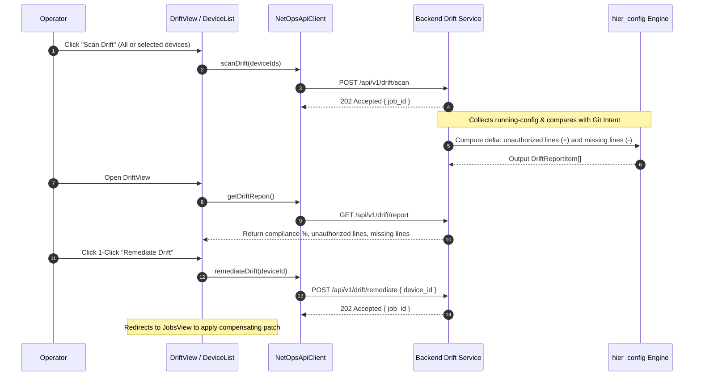
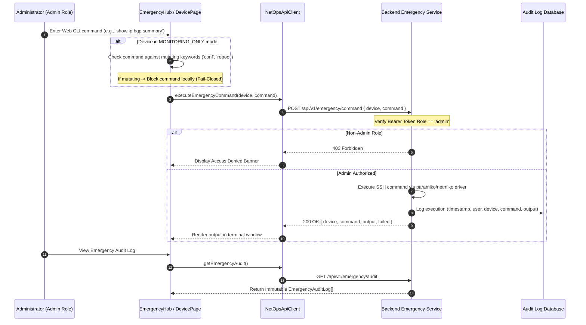
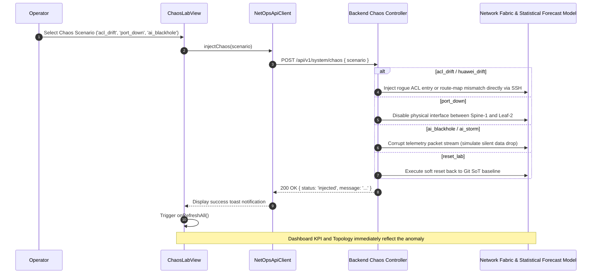

# CROC DREAM NetOps Platform — Frontend Architecture Guide

> **Version**: 3.0.0 (Post-M3 Cognitive Ergonomics & Performance Refactoring)  
> **Status**: Production / Jury Ready  
> **Target Environment**: Web (1080p Ergonomic Fit) & Progressive Mobile Support  

---

## 1. Architecture Overview

### 1.1. Technology Stack
The frontend of the **CROC DREAM NetOps Platform** is built using modern, production-grade web technologies optimized for high cognitive throughput and sub-second operational reflexes:

- **React 19 (`^19.2.8`)**: Next-generation concurrent rendering engine leveraging granular state updates, optimized hooks, and robust `Suspense` transitions.
- **TypeScript 5.8+ (`~6.0.2`)**: Strict static type system enforcing compile-time safety across all network models, GitOps SoT intent specifications, and API client interactions (`strict: true`, zero `any` slips).
- **Vite 6+ (`^8.3.0`)**: Ultra-fast build pipeline and ES-module development server with custom Rollup code-splitting strategies, compression middlewares, and immutable asset caching.
- **Tailwind CSS v4 (`^4.3.3`)**: Engine with native CSS variable theming, zero runtime CSS injection overhead, and sub-millisecond selector evaluation.
- **Monaco Editor (`@monaco-editor/react ^4.7.0`)**: Professional side-by-side and unified diff inspector for hierarchical network configuration comparisons (`hier_config`). Fully decoupled into an asynchronous chunk to prevent main-thread blocking.
- **Lucide React (`^1.48.0`)**: Iconography isolated into a dedicated bundle chunk.

### 1.2. Cognitive Ergonomics & "Quiet UI" Philosophy
Managing a heterogenous CLOS data center fabric (Cisco IOS-XE, Arista EOS, Huawei VRP, Juniper Junos, Eltex MES/ESR, YADRO Kornfe, Linux Server) under high network load demands total elimination of cognitive noise:

1. **Anti-Alert Fatigue ("Quiet Interface")**:
   - In steady-state operation, the interface remains visually muted using dark neutral slate tones (`#090d16` background, `#111827` cards).
   - Signal colors (warning amber `#f59e0b`, critical crimson `#f43f5e`) are strictly reserved for genuine anomalies and predicted threshold breaches.
2. **Pre-Attentive Perception (<3-Second Rule)**:
   - High-level fabric health, active drift counts, and impending Statistical Forecast telemetry anomalies are immediately visible on the 1080p dashboard without requiring scrolling.
3. **Progressive Disclosure**:
   - High-level KPIs and topology health are displayed first. In-depth configuration diffs, BGP neighbor tables, and telemetry timeseries are loaded on demand via context drawers (`DeviceDrawer`) and modal inspectors without losing screen context.
4. **Fitts's & Hick's Law Optimization**:
   - The distance and number of choices between anomaly discovery and remediation are minimized: every anomaly card, alert radar item, and topology popover contains immediate 1-click action triggers (`Open`, `Diff`, `Dry-run`).
   - The contextual AI Copilot automatically ingests active screen and device coordinates, returning focused conclusions and embedded 1-Click Action Resolution buttons.

---

## 2. Component & Hook Responsibility Catalog

The application architecture is organized into a modular tree where state ownership flows cleanly from the root orchestrator down to atomic UI primitives.

### 2.1. Component Responsibility Matrix

| # | Component | Path | Lines | Architectural Responsibility | Internal Hooks | Props & Event Callbacks |
|---|---|---|---|---|---|---|
| **—** | `App` | `src/App.tsx` | 530 | Root orchestrator: active tab routing, global modal state, RBAC token sync, adaptive polling (1.5s/5s), visibility lifecycle sync, and priority Escape key stack. | `useState`, `useEffect`, `useMemo`, `useCallback` | None (Application Root) |
| **—** | `api` | `src/api.ts` | 650 | Centralized REST client: token management, typed API dispatch, error normalization, emergency SSH CLI execution, and share URL generation. | None (Class instance) | Exported singleton instance `api` |
| **—** | `constants` | `src/constants.ts` | 45 | Platform constants: navigation tab descriptors (`TAB_DEFINITIONS`), vendor display names (`PLATFORM_NAMES`), and CLOS tier roles (`ROLE_NAMES`). | None (Static definitions) | Exported constants |
| **1** | `Header` | `src/components/layout/Header.tsx` | 166 | Global top navigation bar: API health pill, Copilot toggle, jury share trigger, Dark/Light theme switcher, RU/EN locale toggle, and RBAC role badge. | Stateless | `activeTab`, `setActiveTab`, `userRole`, `setUserRole`, `apiHealthy`, `copilotOpen`, `onToggleCopilot`, `locale`, `setLocale`, `theme`, `setTheme`, `onOpenWelcomeModal`, `onOpenShareModal` |
| **2** | `Sidebar` | `src/components/layout/Sidebar.tsx` | 102 | Desktop side navigation menu grouping routes into Overview, Inventory, Automation, and Testing categories with keyboard accessibility. | Stateless | `activeTab`, `setActiveTab`, `locale` |
| **3** | `MobileNav` | `src/components/layout/MobileNav.tsx` | 303 | Responsive mobile bottom navigation bar (4 primary tabs) + slide-up Bottom Sheet drawer for secondary views, role switching, and locale selection. | `useState` (`moreMenuOpen`) | `activeTab`, `setActiveTab`, `locale`, `theme`, `setTheme`, `userRole`, `setUserRole`, `setLocale`, `onToggleCopilot`, `onOpenSearch`, `onOpenShare` |
| **4** | `Dashboard` | `src/components/views/Dashboard.tsx` | 666 | Executive fabric operations center: KPI metrics strip (<0.5s visual scan), onboarding empty-states, node sparkline grid, interactive CLOS 2D topology, Statistical Forecast risk radar, and recent automation jobs. | `useState`, `useEffect`, `useMemo` | `devices`, `jobs`, `userRole`, `locale`, `onOpenTab`, `onOpenDevice`, `onRunDryRun`, `onOpenDiff`, `onSyncInventory` |
| **5** | `DeviceList` | `src/components/views/DeviceList.tsx` | 532 | High-density inventory table (Zabbix/NetBox pattern): vendor/role filters, text search, separate `Oper Status` vs `Intent Status` columns, telemetry sparklines, 24h state timelines, and bulk actions. | `useState`, `useMemo` | `devices`, `loading`, `userRole`, `locale`, `onRefresh`, `onRunDryRun`, `onScanDrift`, `onSyncInventory`, `onLintIntent`, `onOpenDevice`, `onOpenDiff`, `onDeleteDevice` |
| **6** | `DeviceDrawer` | `src/components/modals/DeviceDrawer.tsx` | 415 | Contextual slide-over drawer (and mobile bottom sheet) for non-disruptive device inspection: Interface intents, BGP peer states, running-config preview, and quick dry-run/diff buttons. | `useState`, `useEffect` | `deviceId`, `onClose`, `userRole`, `locale`, `onOpenDiff`, `onRunDryRun`, `onOpenFullPage` |
| **7** | `DevicePage` | `src/components/views/DevicePage.tsx` | 1236 | Comprehensive node passport: hardware specifications, IPAM/access profile, Git Intent model, interactive What-If Statistical Forecast forecast simulator, live SSH Web CLI with fail-closed guard, and emergency actions. | `useState` (17 states), `useEffect` | `deviceId`, `userRole`, `locale`, `onBack`, `onRunDryRun`, `onScanDrift`, `onAskCopilot`, `onDeleteDevice` |
| **8** | `DiffViewer` | `src/components/views/DiffViewer.tsx` | 630 | Hierarchical configuration diff inspector (`hier_config`): Monaco side-by-side / inline editor with lightweight fallback, AI Guard risk scoring (`api.explainDiff`), and commit-confirmed deployment button. | `useState`, `useEffect` | `jobs`, `selectedJobId`, `locale`, `theme`, `onSelectJob`, `onDeploy` |
| **9** | `JobsView` | `src/components/views/JobsView.tsx` | 391 | Automation execution streamer: job list, stage progress bar, color-coded stage terminal logs (`preflight`, `render`, `diff`, `apply`, `rollback`), auto-scroll, log filtering, and Markdown compliance export. | `useState`, `useRef`, `useEffect` | `jobs`, `loading`, `selectedJobId`, `locale`, `onSelectJob`, `onDeploy`, `onOpenDiff`, `onRefresh` |
| **10** | `DriftView` | `src/components/views/DriftView.tsx` | 278 | Configuration compliance audit console: fabric-wide compliance percentage, diff cards showing unauthorized additions (`+`) and missing intent (`-`), and 1-click automated remediation. | `useState`, `useEffect` | `locale`, `onRemediate`, `onScanDrift` |
| **11** | `ChaosLabView` | `src/components/views/ChaosLabView.tsx` | 191 | Chaos Engineering testing studio: triggers for rogue ACL drift, Huawei BGP drift, physical port down, silent telemetry blackholes, and load surges, plus factory reset to Git baseline. | `useState` | `locale`, `onRefreshAll` |
| **12** | `CopilotPanel` | `src/components/modals/CopilotPanel.tsx` | 335 | Contextual AI assistant drawer: automatic binding of active screen and selected device ID, streaming message history, Markdown formatting, and embedded 1-Click Action buttons. | `useState`, `useRef`, `useCallback`, `useEffect` | `open`, `onClose`, `deviceId`, `locale`, `request`, `activeScreen`, `onRunDryRun`, `onOpenDiff`, `onScanDrift`, `onOpenDevice`, `onRemediate`, `onOpenTab` |
| **13** | `CommandPalette`| `src/components/layout/CommandPalette.tsx` | 84 | Global search palette (`Ctrl+K` / `Cmd+K`): fuzzy search across fabric devices (hostname, IP, vendor) and platform views with keyboard arrow navigation and Escape dismissal. | `useState`, `useRef`, `useMemo`, `useEffect` | `open`, `onClose`, `devices`, `onOpenDevice`, `onOpenTab` |
| **14** | `DryRunModal` | `src/components/modals/DryRunModal.tsx` | 263 | Pre-flight Dry-Run validation modal: Git branch/commit metadata, Pydantic lint status, automatic Blast Radius calculation (Low/Med/High, % fabric affected), target device pills, and Enter shortcut. | `useState`, `useMemo`, `useCallback`, `useEffect` | `open`, `onClose`, `onConfirm`, `deviceIds`, `devices`, `locale`, `gitBranch`, `gitCommit` |
| **15** | `EmergencyHub` | `src/components/views/EmergencyHub.tsx` | 570 | Admin out-of-band operational hub: Zero-trust RBAC gate, live interactive SSH Web CLI to all 6 CLOS nodes with vendor presets, direct hot-patch studio, soft/hard fabric reset, and audit trail. | `useState` (13 states), `useEffect` | `currentRole`, `onSwitchRole` |
| **16** | `ForecastChart`| `src/components/charts/ForecastChart.tsx` | 384 | Vector SVG telemetry chart: Statistical Forecast median & confidence bounds, continuous risk bands (Normal 0-70%, Warning 70-85%, Critical 85-100%), and Grafana event markers with tooltips. | `useState`, `useMemo` | `data: Forecast` |
| **17** | `TopologyMap` | `src/components/charts/TopologyMap.tsx` | 501 | Dynamic 2D CLOS fabric SVG topology: automated layer tiering (Border, Spine, Leaf, Server), bandwidth utilization coloring, animated congestion links, and popovers with 1-click actions. | `useState`, `useMemo`, `useEffect` | `devices`, `alerts`, `locale`, `onSelectDevice`, `onOpenDiff`, `onRunDryRun` |
| **18** | `AddDeviceModal`| `src/components/modals/AddDeviceModal.tsx` | 561 | Two-step safe onboarding wizard: Step 1 initiates zero-trust SSH probe; Step 2 displays discovered hardware/LLDP attributes, sets platform/role, and registers device in `MONITORING_ONLY` mode. | `useState` (14 states) | `isOpen`, `onClose`, `onSuccess`, `userRole` |
| **19** | `WelcomeModal` | `src/components/modals/WelcomeModal.tsx` | 352 | First-time onboarding modal: auto-dismissed if `?token=` is present; supports instant Owner mode or remote cluster attachment via token and backend URL. | `useState`, `useEffect` | `isOpen`, `onClose`, `locale`, `setLocale` |
| **20** | `ShareModal` | `src/components/modals/ShareModal.tsx` | 168 | Access delegation dialog: one-click generation of read-only Jury access links (`?token=dev-jury-token`) and full administrative access links (`?token=dev-admin-token`). | `useState` | `isOpen`, `onClose`, `userRole`, `locale` |
| **21** | `SlidesPresentation` | `src/components/views/SlidesPresentation.tsx` | 615 | Integrated 5-slide jury presentation: architectural tenets, end-to-end GitOps pipeline, multi-vendor syntax comparisons (Cisco, Arista, Juniper, Eltex, YADRO), and live demo launcher. | `useState`, `useCallback` | `onLaunchDemo`, `onOpenTab` |
| **22** | `ShortcutsModal` | `src/components/modals/ShortcutsModal.tsx` | 135 | Platform hotkey & RBAC reference modal: cheatsheet for `Ctrl+K`, `Esc`, `Enter`, `?`, role permissions matrix, and Esc stack dismissal. | stateless | `isOpen`, `onClose`, `locale` |
| **23** | `ui` | `src/components/layout/ui.tsx` | 362 | Atomic design primitives: `StatusBadge`, `OperStatusBadge`, `IntentStatusBadge`, `Sparkline`, `StateTimeline`, `ManagementModeBadge`, `Panel`, `BentoCard`, `JobStatusBadge`, and `Modal`. | `useEffect` (Inside `Modal` for Escape) | Shared styling and primitive props |

---

## 3. Complete Data Flow Architecture

The platform combines RESTful synchronization, adaptive polling, and deterministic event propagation.

```
                           +---------------------------+
                           |   Browser Window Event    |
                           |  (focus / visibilitySync) |
                           +-------------+-------------+
                                         |
                                         v
+------------------+             +---------------+             +--------------------+
|  Timer Trigger   | ----------> |  App.tsx Root | <---------- | User UI Action     |
| (1.5s / 5s Poll) |             |  Orchestrator |             | (Click / Shortcut) |
+------------------+             +-------+-------+             +--------------------+
                                         |
                                         v
                               +-------------------+
                               | NetOpsApiClient   |
                               | (Bearer Token)    |
                               +---------+---------+
                                         |
                  +----------------------+----------------------+
                  |                      |                      |
                  v                      v                      v
        +-------------------+  +-------------------+  +-------------------+
        | Inventory / State |  | Jobs & Automation |  | Telemetry & Guard |
        |  /devices, /diff  |  | /dry-run, /deploy |  | /forecast, /guard |
        +-------------------+  +-------------------+  +-------------------+
```

---

### 3.1. REST API Hydration & Adaptive Polling (1.5s / 5s) + Visibility Sync

To eliminate server overhead while guaranteeing instant UI responsiveness during active automation:

1. **Active Job Detection**:
   `App.tsx` evaluates whether any automation job is in `RUNNING` or `PENDING` state:
   ```ts
   const hasActiveJob = jobs.some(j => j.status === 'RUNNING' || j.status === 'PENDING');
   const pollMs = hasActiveJob ? 1500 : 5000;
   ```
2. **Referential Bail-Out**:
   When polling responses arrive, `areDevicesEqual` and `areJobsEqual` perform strict field equality comparisons. If no data fields have mutated, state setters are bypassed, avoiding unnecessary component re-render cascades.
3. **Visibility Lifecycle Sync**:
   When an operator switches back to the tab, `visibilitychange` and `focus` events trigger an immediate state refresh.



---

### 3.2. Pre-flight Dry-Run Execution Pipeline

The pre-flight Dry-Run pipeline verifies GitOps intent against live equipment without applying changes:

1. Operator triggers Dry-Run from Dashboard, DeviceList, TopologyMap, DeviceDrawer, or Copilot.
2. `DryRunModal` renders Git commit metadata, calculates **Blast Radius** (% of fabric nodes, affected links, and BGP peers), and waits for confirmation.
3. `api.createDryRun(deviceIds)` enqueues the job (`POST /api/v1/jobs/dry-run`).
4. The backend pulls Git intent, collects running-config, and computes hierarchical diffs (`hier_config`).
5. The UI switches to `JobsView`, streaming stage logs (`preflight` -> `render` -> `diff`).



---

### 3.3. Commit-Confirmed Deployment with 180s Rollback Guard

Applying configuration changes follows transaction-safe deployment patterns:

1. From `DiffViewer` or `JobsView`, the operator reviews the generated `remediation_patch` and LLM risk score.
2. The operator clicks **Apply Deployment**.
3. `api.createDeploy(jobId, confirmedBy)` sends `POST /api/v1/jobs/deploy`.
4. The backend issues vendor-specific `commit confirmed 180` commands to target equipment.
5. Post-deployment health verification runs:
   - If connectivity and telemetry pass, the commit is confirmed.
   - If telemetry fails or connectivity is lost, the 180s timer automatically reverts the configuration.

```mermaid
sequenceDiagram
    autonumber
    participant OP as Operator (Role: Operator / Admin / Owner)
    participant DV as DiffViewer / JobsView
    participant API as NetOpsApiClient
    participant BE as Backend Deploy Service
    participant DEV as Physical CLOS Fabric Node

    OP->>DV: Review hierarchical diff & Click "Apply Deployment"
    DV->>API: createDeploy(dryRunJobId, confirmedBy)
    API->>BE: POST /api/v1/jobs/deploy { job_id, confirmed_by }
    BE-->>API: 202 Accepted { job_id: deployJobId, status: 'RUNNING' }
    API-->>DV: Redirect to JobsView (Streaming live logs)

    rect rgb(20, 30, 45)
        Note over BE,DEV: Atomic Commit Confirmed Transaction
        BE->>DEV: Push remediation patch with 'commit confirmed 180'
        DEV-->>BE: Configuration staged (180s auto-rollback timer armed)
        BE->>DEV: Execute post-flight telemetry & BGP ping checks
        alt Health Check Passed
            BE->>DEV: Send 'commit' (Confirm permanent change)
            BE->>BE: Mark job status = 'SUCCESS'
        else Health Check Failed or Connectivity Lost
            BE->>DEV: Rollback triggered / 180s timer expires
            DEV-->>BE: Restored previous running-config
            BE->>BE: Mark job status = 'FAILED'
        end
    end
    BE-->>DV: Final JobDetail & Markdown Compliance Record
```



---

### 3.4. Drift Detection & Remediation Flow

Out-of-band changes introduced directly onto devices are automatically detected and resolved:



---

### 3.5. Emergency Live SSH Console (Fail-Closed Zero-Trust RBAC & Session Logging)

When emergency out-of-band intervention is required:

1. **Role Gating**: Only users with the `admin` or `owner` role can access the Emergency Hub.
2. **Monitoring Mode Guard**: Devices flagged as `MONITORING_ONLY` fail-closed: mutating commands (`conf`, `reboot`, `system-view`) are blocked on the client side.
3. **Audit Logging**: Every command execution or hot-patch application is recorded in an append-only audit log.



---

### 3.6. Chaos Lab Incident Simulation & Audit Trail

Chaos Engineering scenarios test the platform's detection and automated recovery systems:



---

### 3.7. Multi-Role RBAC & Dynamic Bearer Tokens

The platform provides a four-tier Role-Based Access Control hierarchy:

```
               [ Owner ]  <-- Full access + ShareModal token distribution
                   |
               [ Admin ]  <-- Topology orchestration + Emergency Web CLI + Hot-patches
                   |
             [ Operator ] <-- Trigger Dry-Runs, Deploys, Drift scans, and Remediation
                   |
              [ Viewer ]  <-- Read-only mode for jury; mutation controls suppressed
```

- When a role is selected via `Header`, `WelcomeModal`, or URL parameter (`?token=dev-jury-token`), the token is persisted to `localStorage` and synchronized with `api.setToken()`.
- Every outgoing HTTP request attaches `Authorization: Bearer <token>`.
- UI buttons for destructive or mutating operations are dynamically hidden or disabled for read-only roles.

---

### 3.8. Dual-Theme System (Dark Neutral / Light) with Zero-Flicker Persistence

The theme system enforces ergonomic visual discipline:

1. **Zero-Flicker Initialization**:
   During initial script execution, `localStorage.getItem('netops_theme')` is evaluated.
   The `data-theme="dark|light"` attribute and CSS classes (`theme-dark dark` or `theme-light`) are written synchronously to `document.documentElement`.
2. **Semantic CSS Tokens**:
   All component styles reference CSS variables defined in `src/index.css`:
   - `--bg-main`: Base background (`#090d16` in dark mode)
   - `--bg-card`: Surface card background (`#111827`)
   - `--text-primary`: High-contrast typography (`#f3f4f6`)
   - `--border-subtle`: Structural divider borders (`rgba(255, 255, 255, 0.08)`)
   - `--topology-link`: Network link line color with responsive contrast

---

## 4. Performance & Optimization Architecture

### 4.1. Route-Level Code-Splitting & Monaco Decoupling
To achieve fast First Contentful Paint (FCP) and low Total Blocking Time (TBT), heavy secondary views and third-party libraries are isolated into asynchronous chunks using `React.lazy()` and `Suspense`:

- **Main Entry Chunk (`dist/assets/index-*.js`)**: Kept at **~126 kB** (gzip: ~31 kB), well below the 150 kB threshold.
- **Monaco Editor Chunk (`dist/assets/monaco-*.js`)**: Decoupled to **~14 kB** (gzip: ~4.7 kB), loaded only when navigating to `DiffViewer`.
- **Heavy View Chunks**: `DevicePage` (54 kB), `EmergencyHub` (20.5 kB), `SlidesPresentation` (29.5 kB), and `DiffViewer` (18.5 kB) load on demand with spinner fallbacks.

```ts
// src/App.tsx
const DevicePage = lazy(() => import('./components/DevicePage').then(m => ({ default: m.DevicePage })));
const DiffViewer = lazy(() => import('./components/DiffViewer').then(m => ({ default: m.DiffViewer })));
const EmergencyHub = lazy(() => import('./components/EmergencyHub').then(m => ({ default: m.EmergencyHub })));
```

### 4.2. Referential Polling Bail-Out
Continuous adaptive polling can cause CPU churn and unnecessary re-renders if incoming responses recreate object identities. `App.tsx` prevents this by using shallow-field memoization:

```ts
function areDevicesEqual(a: Device[], b: Device[]): boolean {
  if (a === b) return true;
  if (a.length !== b.length) return false;
  for (let i = 0; i < a.length; i++) {
    const da = a[i], db = b[i];
    if (
      da.id !== db.id ||
      da.hostname !== db.hostname ||
      da.status !== db.status ||
      da.oper_status !== db.oper_status ||
      da.management_mode !== db.management_mode ||
      da.platform !== db.platform ||
      da.role !== db.role ||
      da.management_ip !== db.management_ip ||
      da.last_checked_at !== db.last_checked_at ||
      da.updated_at !== db.updated_at
    ) return false;
  }
  return true;
}
```
If `areDevicesEqual` and `areJobsEqual` return `true`, state setters are skipped, preventing re-renders in `Dashboard`, `TopologyMap`, and `DeviceList`.

### 4.3. SVG Path & Coordinate Memoization
- In `TopologyMap.tsx`, node coordinates (`nodes`), link trajectories (`links`), and active hierarchical tiers (`activeLayers`) are memoized using `useMemo([devices])`. SVG link paths recalculate only when nodes change position or topology mode toggles.
- In `ForecastChart.tsx`, bezier curve control points, quantile polygon paths, and event marker coordinates are cached with `useMemo([data])`, ensuring smooth hover interactions at 60 FPS.

### 4.4. Code Quality & Linting Compliance
- **Zero Oxlint Violations**: The entire codebase is verified with `oxlint` across 116 rules, producing **0 errors and 0 warnings**.
- **Rules of Hooks**: Every React hook (`useState`, `useEffect`, `useMemo`, `useCallback`, `useRef`) is invoked strictly at the top level of components, avoiding conditional executions.

---

## 5. Verification & Quality Matrix

| Dimension | Target Standard | Verification Tool | Pass Condition |
|---|---|---|---|
| **TypeScript Compilation** | Project References & App Config | `npx tsc -b` & `npx tsc -p tsconfig.app.json --noEmit` | Exit code 0, 0 type errors |
| **Production Build** | Rollup / Vite Production Bundle | `npm run build` | Exit code 0, entry bundle < 150 kB |
| **Static Code Analysis** | Oxlint Linter | `npx oxlint` | 0 warnings, 0 errors across all 28 files |
| **Browser Console Cleanliness** | Unhandled Exceptions & Errors | Playwright Test Suite | `console.error == 0`, `page_error == 0` |
| **Cognitive Ergonomics** | 1080p Zero-Scroll Overview | `probe_m3_ergonomics.py` | Full fabric status visible in <3 seconds |
| **Keyboard Accessibility** | Priority Modal Dismissal | `probe_m3_ergonomics.py` | `Escape` priority: DryRunModal -> Search -> Copilot |
| **Forecast Visualization** | Statistical Forecast Quantiles & Event Markers | `probe_forecast_chart.py` | 4 marker types, gradient bands, 0 out-of-bounds exceptions |

### 5.1. Automated Playwright Verification Suites

1. **Ergonomics & Action Resolution Suite (`tests/probe_m3_ergonomics.py`)**:
   - Launches Chromium in full HD resolution (`1920x1080`).
   - Verifies sequential Escape key dismissal order:
     - Nested stack 1: `DryRunModal` closes first.
     - Nested stack 2: `CommandPalette` closes second.
     - Nested stack 3: `CopilotPanel` closes third.
   - Tests `Ctrl+K` keyboard shortcut toggle behavior.
   - Verifies contextual AI Copilot synchronization (active screen and device payload forwarding).
   - Validates that `console.error` count equals 0 throughout all test flows.

2. **Forecast Chart & Statistical Forecast Suite (`tests/probe_forecast_chart.py`)**:
   - Intercepts API calls to test edge-case telemetry payloads.
   - Tests event markers (`DEPLOY`, `DRIFT_DETECTED`, `REMEDIATE`, `CHAOS`) and their interactive hover tooltips.
   - Verifies gradient threshold bands (Normal 0-70%, Warning 70-85%, Critical 85-100%).
   - Asserts zero SVG coordinate out-of-bounds errors and clean browser console logs.
